# Tutoriel illustré – Affichage Kumite V2

Ce guide suit un tournoi de démonstration du début à la fin : la **Coupe de Noël 2026**, sur 2 tatamis, avec 16 compétiteurs fictifs. Toutes les images sont de vraies captures de l'application.

**Sommaire**

1. [Les rôles](#1-les-rôles)
2. [Installer l'application (une seule fois)](#2-installer-lapplication-une-seule-fois)
3. [Créer un tournoi (super-admin)](#3-créer-un-tournoi-super-admin)
4. [Se connecter à un tournoi](#4-se-connecter-à-un-tournoi)
5. [Préparer le tournoi (organisation)](#5-préparer-le-tournoi-organisation)
6. [Le jour J : la table de marque](#6-le-jour-j--la-table-de-marque)
7. [Suivre tous les tatamis (organisation)](#7-suivre-tous-les-tatamis-organisation)
8. [La page publique](#8-la-page-publique)
9. [Résultats et exports](#9-résultats-et-exports)
10. [Imprimer les diplômes](#10-imprimer-les-diplômes)
11. [Après le tournoi](#11-après-le-tournoi)
12. [Questions fréquentes](#12-questions-fréquentes)

---

## 1. Les rôles

| Rôle | Qui | Comment il entre | Ce qu'il fait |
|---|---|---|---|
| **Super-admin** | le responsable des tournois du club | `admin.html` + mot de passe | crée, archive et supprime les tournois |
| **Organisateur** | 1 ou 2 responsables de la compétition | clé du tournoi + **code organisateur** | inscriptions, pools, tatamis, règles, sons, résultats, diplômes |
| **Table de marque** | les bénévoles de chaque tatami | clé du tournoi + **code des tables** + n° de tatami | font tourner les combats de **leur** tatami |
| **Public** | parents, coachs | lien de la page publique | consultent en direct, sans code |

Chaque tournoi a une **clé** de 8 caractères (ici `K4XV-RCT6`). Pour n'avoir qu'un seul code, il suffit de mettre le même code organisateur et tables.

---

## 2. Installer l'application (une seule fois)

L'installation sur Infomaniak (sous-domaine, base de données, `config.php`) est détaillée dans le [README](../README.md#installation-sur-infomaniak). Une fois les fichiers déposés et `config.php` rempli, ouvrez `install.php` dans le navigateur.

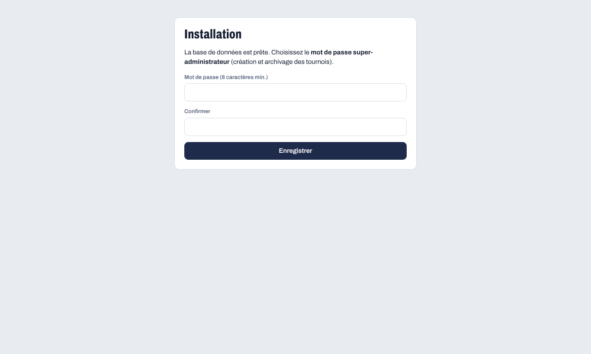

Choisissez le **mot de passe super-admin** (8 caractères minimum), puis **Enregistrer**.

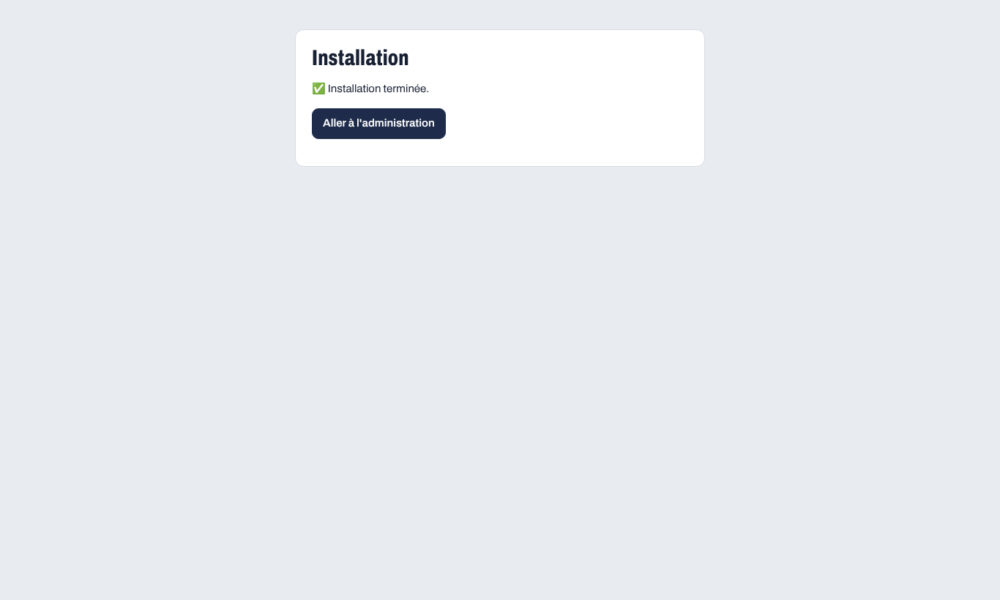

> Si la page affiche une erreur (base introuvable, droits manquants…), elle en donne la cause. Le tableau de dépannage du [README](../README.md#en-cas-derreur-à-linstallation) explique quoi corriger.

---

## 3. Créer un tournoi (super-admin)

Ouvrez `admin.html` et entrez le mot de passe super-admin.

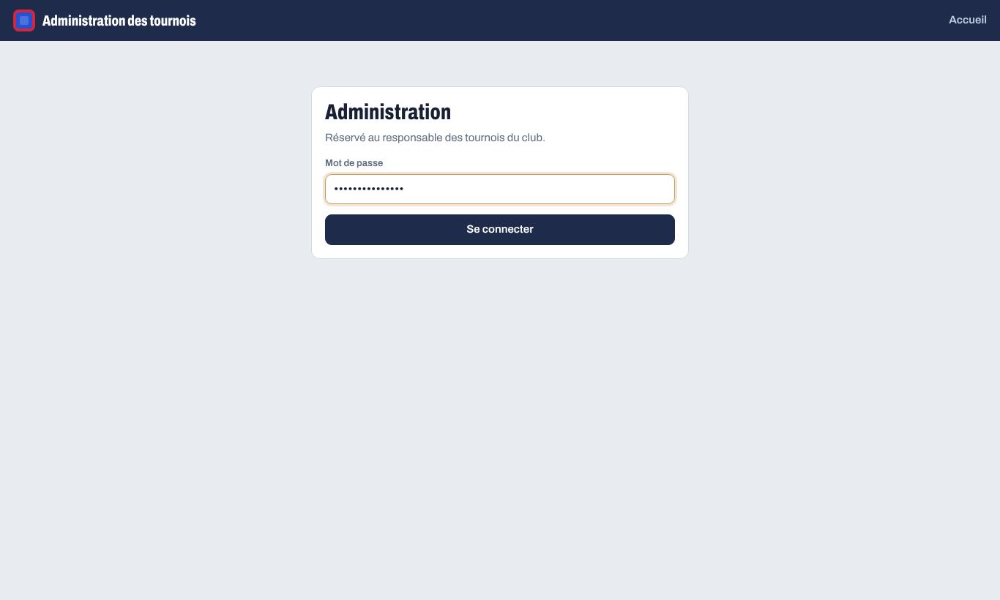

Dans **Créer un tournoi**, remplissez le nom, la date, le lieu, le **nombre de tatamis**, puis les deux codes : **code organisateur** et **code des tables** (4 caractères minimum).

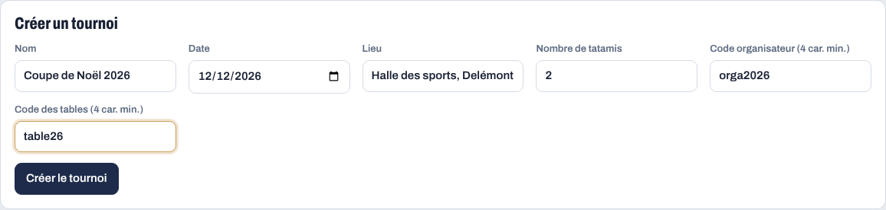

Cliquez **Créer le tournoi** : la **clé** s'affiche et le tournoi apparaît dans la liste.

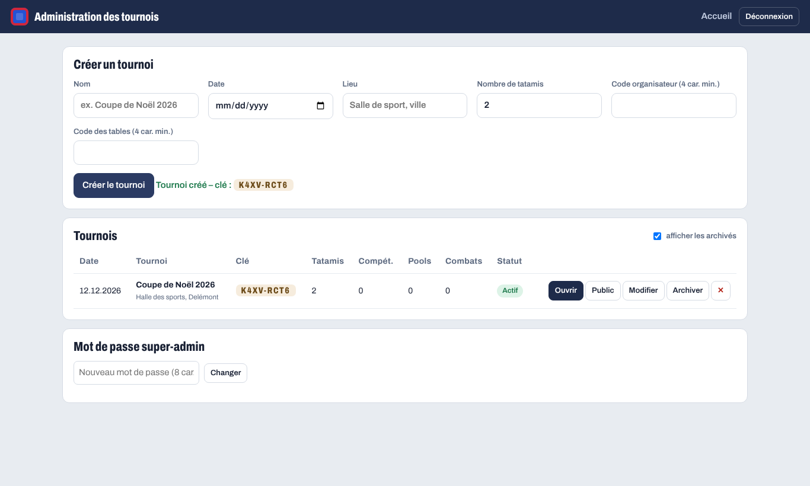

Dans la liste :

- **Ouvrir** entre dans l'organisation du tournoi sans code ;
- **Public** ouvre la page publique ;
- **Modifier** change le nom, la date, le lieu, le nombre de tatamis ou les codes ;
- **Archiver** passe le tournoi en lecture seule une fois terminé ;
- **✕** le supprime définitivement (il faut retaper la clé pour confirmer).

---

## 4. Se connecter à un tournoi

Tout le monde passe par la page d'accueil (`index.html`). Entrez la **clé du tournoi** sur le tapis, puis **Continuer**.

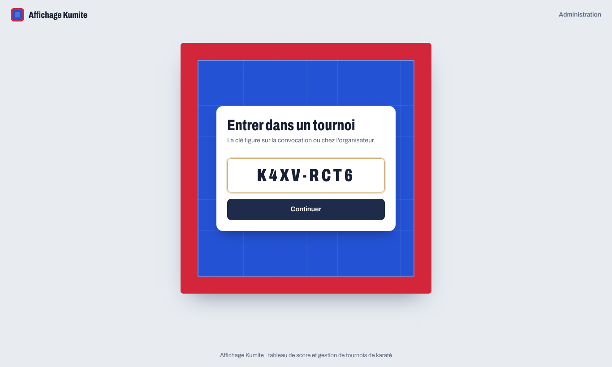

Choisissez votre rôle et entrez le code correspondant.

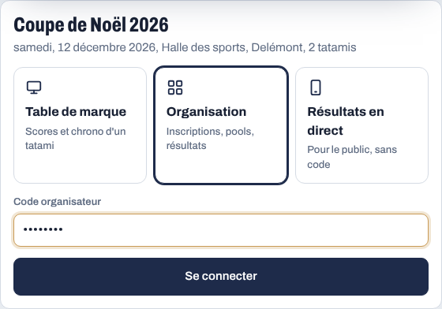

L'appareil se souvient des connexions : la prochaine fois, un bloc **« Reprendre sur cet appareil »** permet de revenir directement. Une connexion reste valable 3 jours.

---

## 5. Préparer le tournoi (organisation)

L'espace d'organisation s'ouvre sur la section **Tatamis**. Le menu de gauche donne accès à toutes les sections ; en haut, le nom du tournoi, sa clé et l'état de la connexion.

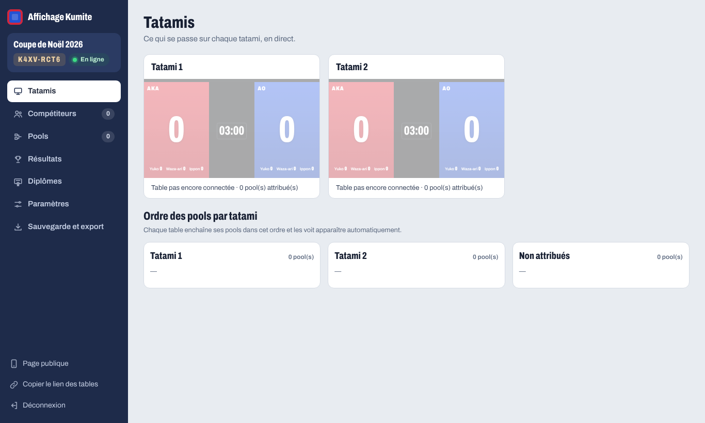

### 5.1 Inscrire les compétiteurs

Section **Compétiteurs** → **Importer un CSV…** Le fichier peut venir d'Excel (séparateur `;` ou `,`). Le bouton **Modèle CSV** télécharge un exemple. Colonnes reconnues :

| Colonne | Exemples acceptés |
|---|---|
| Nom, Prénom (ou une seule colonne « Nom et prénom ») | `Fontaine` / `Léa` |
| Club ou Dojo | `Karaté Club Delémont` |
| Sexe | `F`, `M`, `fille`, `garçon` |
| Âge ou Année de naissance | `11` ou `2015` |
| Poids | `31,5` ou `31.5` |
| Grade ou Ceinture | `6e kyu`, `5. Kyu`, `1er dan`, `jaune`, `verte`… |
| Catégorie (facultatif) | `U12 F` |

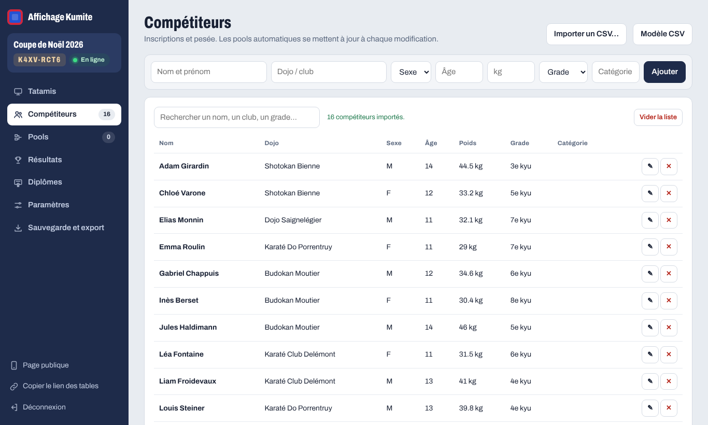

Pour ajouter un compétiteur, utilisez le formulaire du haut. Pour corriger une fiche (par exemple le poids à la pesée), cliquez **✎** sur la ligne : la fiche remonte dans le formulaire, modifiez puis **Enregistrer**.

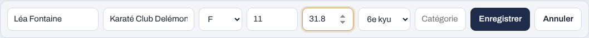

Les pools automatiques se mettent à jour tout seuls après chaque modification, tant qu'aucun de leurs combats n'a été joué.

### 5.2 Créer les pools

Section **Pools** → **Nouveau pool**.

- **Type automatique** : les compétiteurs sont choisis par critères (sexe, âge, poids, grade). La liste des compétiteurs retenus s'affiche en direct sous le formulaire.
- **Type manuel** : vous cochez vous-même les compétiteurs.
- **Tatami** : le tatami sur lequel le pool sera joué.
- **Mode de combat** : WKF, 4 × 15 ou Promo (le chrono et les règles suivent le pool).
- **Format** : *Poule* (chacun contre chacun) ou *Élimination directe*, avec ou sans **repêchage**.

Exemple de poule automatique pour les filles de 10 à 12 ans, en Promo sur le tatami 1 :

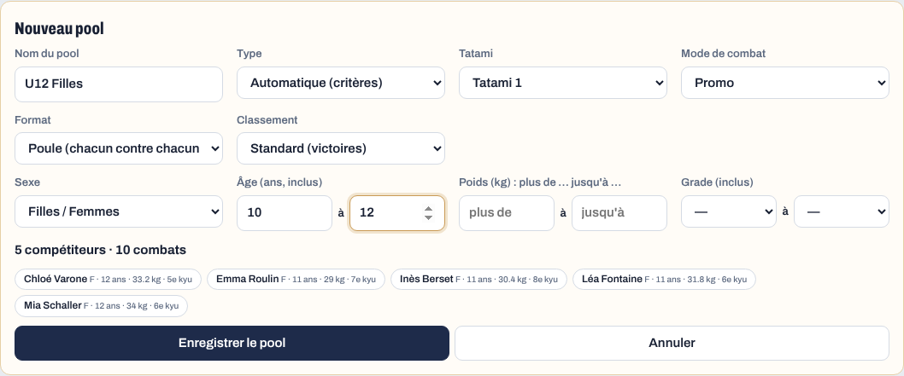

Exemple de tableau à élimination directe avec repêchage pour les garçons de 12 ans maximum jusqu'à 35 kg, sur le tatami 2 :

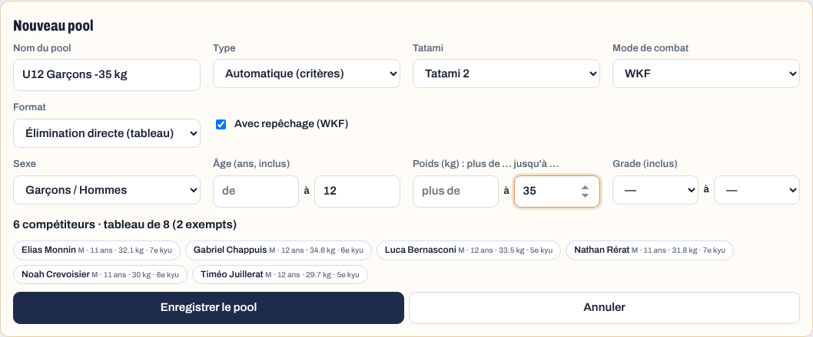

Cliquez **Enregistrer le pool**. Les pools apparaissent sous forme de cartes :

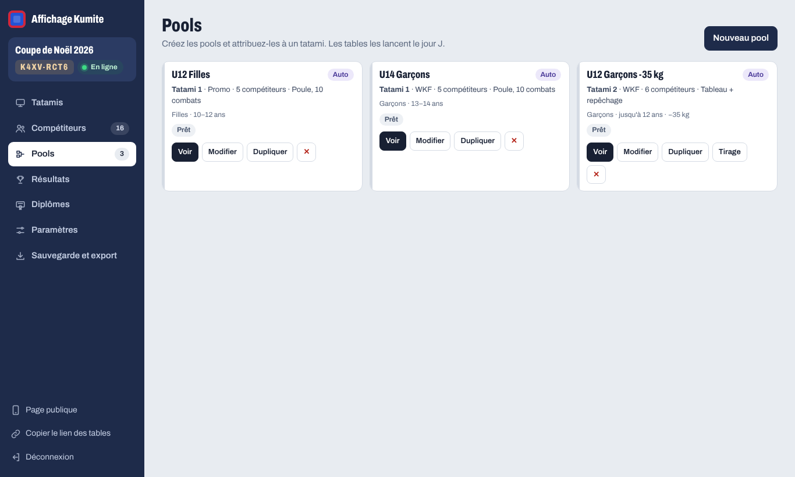

Sur chaque carte :

- **Voir** affiche les combats et le classement du pool ;
- **Modifier** rouvre le formulaire (une fois des combats joués, seuls le nom, le tatami, le mode et le classement restent modifiables) ;
- **Dupliquer** crée une copie, pratique pour préparer la catégorie de poids suivante ;
- **Tirage** refait le tirage au sort d'un tableau (avant le premier combat) ;
- **✕** supprime le pool.

Des **alertes** orange signalent les compétiteurs sans pool, ceux qui sont dans plusieurs pools, et les pools sans tatami.

### 5.3 Ordonner les pools sur chaque tatami

Section **Tatamis**, bloc **Ordre des pools par tatami**. Les flèches **↑ ↓** changent l'ordre de passage ; la liste déroulante (T1, T2…) déplace un pool sur un autre tatami.

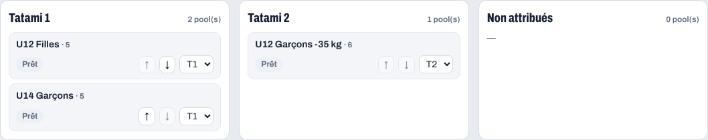

### 5.4 Régler les règles de combat

Section **Paramètres** → **Règles de combat** : durée, moment de l'atoshi baraku, écart de victoire en WKF, durée des assauts en 4 × 15, chronomètre en Promo. Cliquez **Envoyer les règles aux tables**.

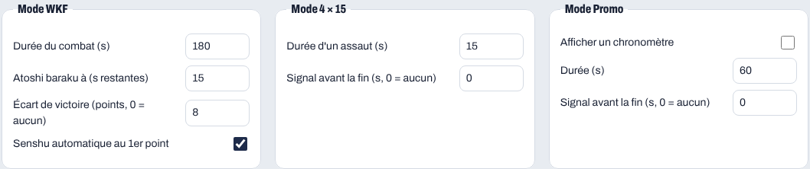

### 5.5 Régler les sons et l'appel des combattants

Toujours dans **Paramètres**, bloc **Sons et appel des combattants** :

- pour l'**atoshi baraku**, la **fin du temps** et l'**appel**, choisissez un des sons proposés ou **Importer un fichier…** (MP3, WAV ou OGG, 1 Mo maximum) ; **▶ Écouter** pour l'essayer ;
- **Appeler automatiquement dès qu'un combat est chargé** : la table joue l'appel sans qu'on touche à rien ;
- **Lire les noms après le son d'appel** : la table annonce le combat avec une voix de synthèse ;
- **Texte lu** : modifiable avec les champs `{tatami}` `{tour}` `{pool}` `{aka}` `{aka_club}` `{ao}` `{ao_club}` ;
- **Voix** et **vitesse** ; **▶ Tester l'appel** fait un essai avec des noms d'exemple.

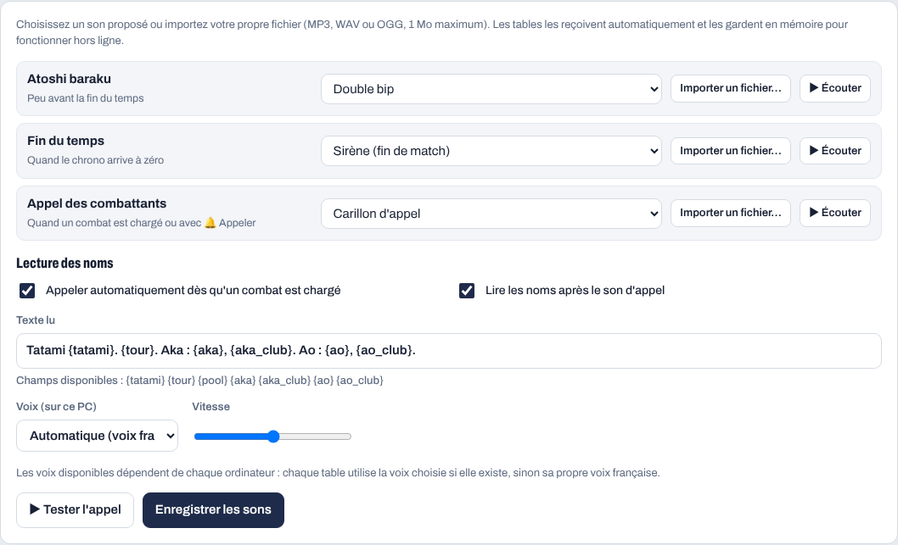

Cliquez **Enregistrer les sons** : les tables les reçoivent automatiquement.

### 5.6 Inviter les tables

En bas du menu, **Copier le lien des tables** copie l'adresse de la page d'accueil avec la clé du tournoi. Envoyez-la aux responsables des tables avec le **code des tables**.

---

## 6. Le jour J : la table de marque

### 6.1 Matériel

Par tatami : un PC avec **Chrome ou Edge**, une **TV branchée en écran étendu**, Internet (Wi-Fi ou câble). Un clavier facilite la saisie des points.

### 6.2 Se connecter

Page d'accueil → clé → **Table de marque** → choisir le **tatami** → **code des tables** → **Se connecter**.

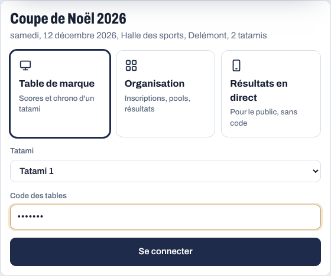

### 6.3 Ouvrir l'écran TV

Cliquez **Ouvrir l'affichage ↗** en haut à droite. Une fenêtre s'ouvre : glissez-la sur la TV, puis **cliquez dedans** pour passer en plein écran et autoriser le son (double-clic pour sortir du plein écran).

> Si rien ne s'ouvre, le navigateur a bloqué la fenêtre : cliquez sur l'icône de fenêtre bloquée dans la barre d'adresse et choisissez « Toujours autoriser ».

### 6.4 Lancer un pool

En bas de la page, l'onglet **Pools du tatami** montre les pools attribués à ce tatami, dans l'ordre fixé par l'organisation. Ils apparaissent tout seuls, sans recharger la page.

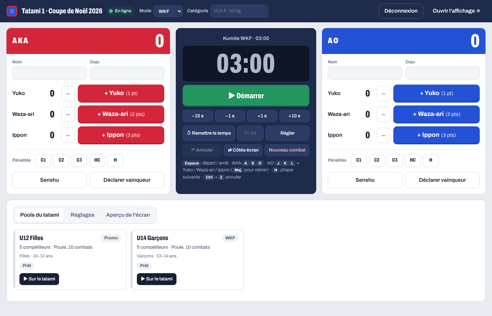

Cliquez **▶ Sur le tatami** sur le premier pool. La TV affiche la liste des compétiteurs du pool :

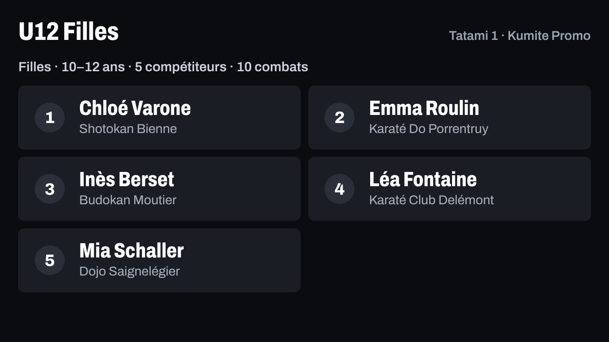

Cliquez **▶ Lancer le pool** dans la barre du haut.

### 6.5 L'appel des combattants

La TV affiche les deux combattants en grand, ainsi que le combat suivant. La table joue le son d'appel puis lit les noms. Le bouton **🔔 Appeler** répète l'appel.

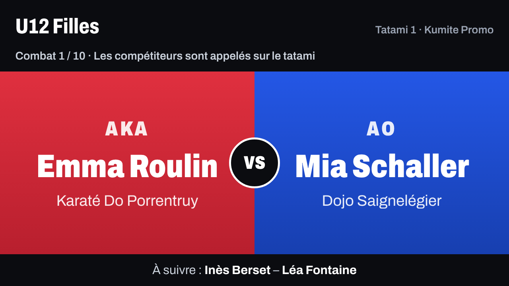

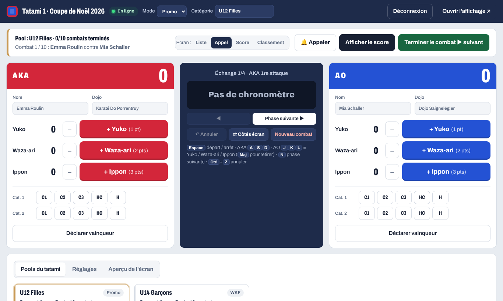

La barre du haut résume le pool (combats terminés, combat en cours) et permet de changer l'écran de la TV : **Liste**, **Tableau** (élimination directe), **Appel**, **Score**, **Classement**.

### 6.6 Le combat

- **Démarrer le chrono** (bouton vert ou **Espace**) : la TV passe automatiquement au score. En mode Promo, sans chronomètre, cliquez **Afficher le score**.
- **Points** : boutons **+ Yuko**, **+ Waza-ari**, **+ Ippon** (le bouton **−** retire un point).
- **Pénalités** : boutons C1, C2, C3, HC, H (cliquer à nouveau sur la dernière pénalité l'annule).
- **Senshu** (WKF) : attribué automatiquement au premier point, modifiable avec le bouton **Senshu**.
- **↶ Annuler** (ou Ctrl+Z) annule la dernière action.

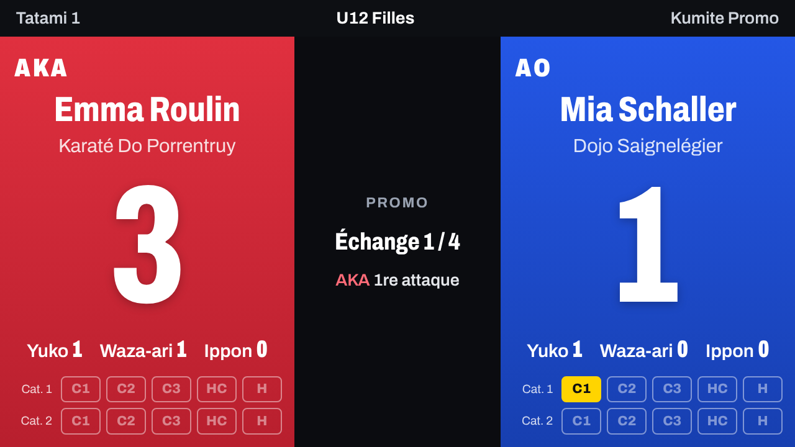

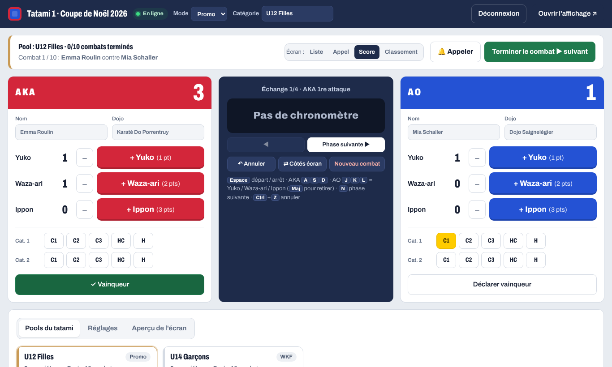

En mode WKF, le chrono est au centre ; l'atoshi baraku et la fin du temps sont signalés à l'écran et par le son :

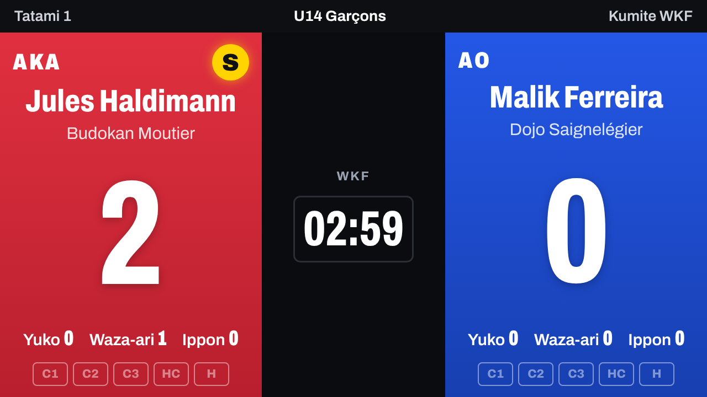

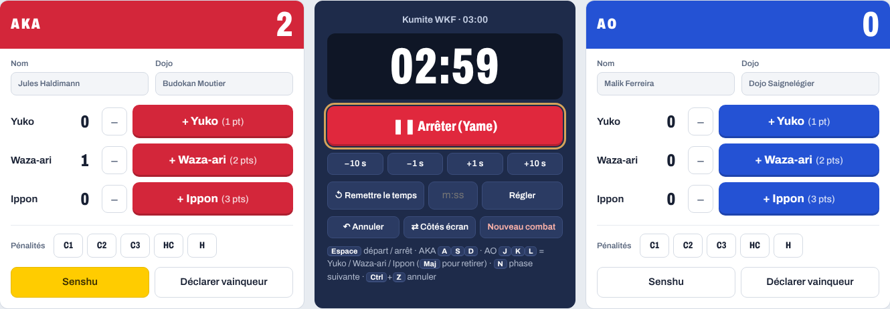

Raccourcis clavier :

| Touche | Action |
|---|---|
| Espace | démarrer / arrêter le chrono |
| A / S / D | Yuko / Waza-ari / Ippon pour AKA |
| J / K / L | Yuko / Waza-ari / Ippon pour AO |
| Maj + touche | retirer le point |
| N | phase ou assaut suivant (Promo, 4 × 15) |
| Ctrl + Z | annuler |

Pour finir le combat : **Déclarer vainqueur** (côté gagnant), puis **Terminer le combat ▶ suivant**. Le résultat part au serveur et la TV appelle aussitôt le combat suivant.

### 6.7 Fin du pool

Après le dernier combat, la TV affiche le classement :

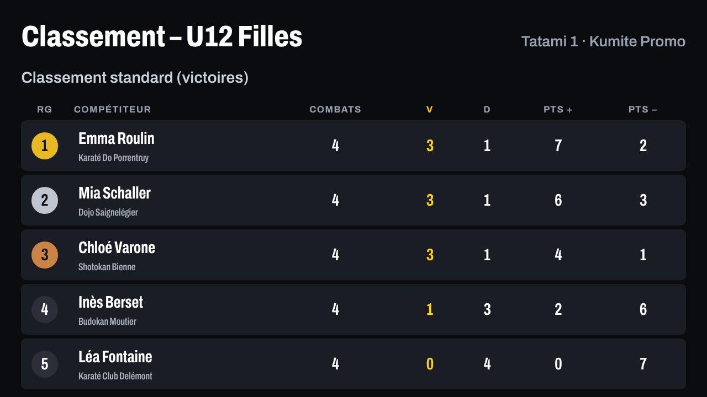

La barre du haut propose alors **Pool suivant ▶** :

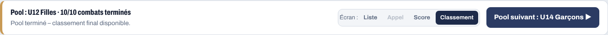

Pour corriger un combat déjà joué, ouvrez la liste des combats sous **Pools du tatami** et cliquez **Rejouer** sur la ligne. En élimination directe, ce n'est possible que si aucun des deux compétiteurs n'a déjà combattu au tour suivant.

### 6.8 Élimination directe et repêchage

Pour un tableau, la TV affiche l'écran **Tableau**. Les exempts passent directement au tour suivant. Le combat en cours est entouré en jaune.

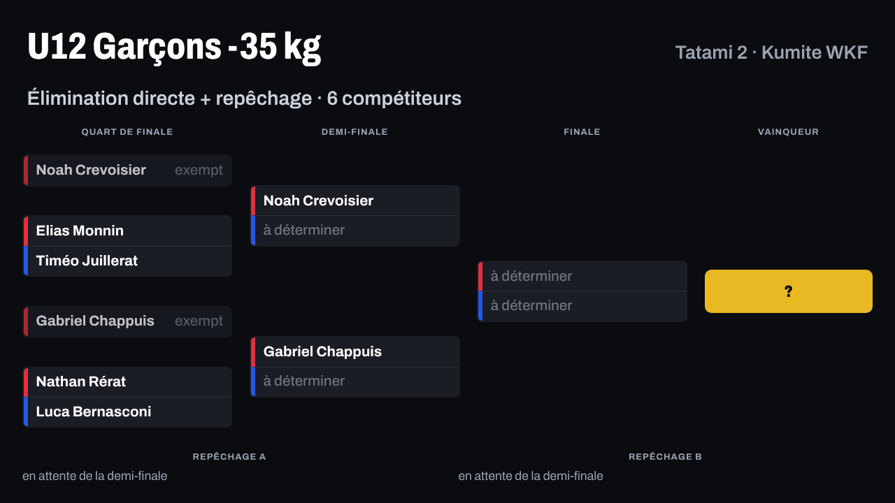

Quand une demi-finale est jouée, les compétiteurs battus par ce finaliste sont repêchés automatiquement. Les combats de repêchage s'affichent en bas et passent avant la finale.

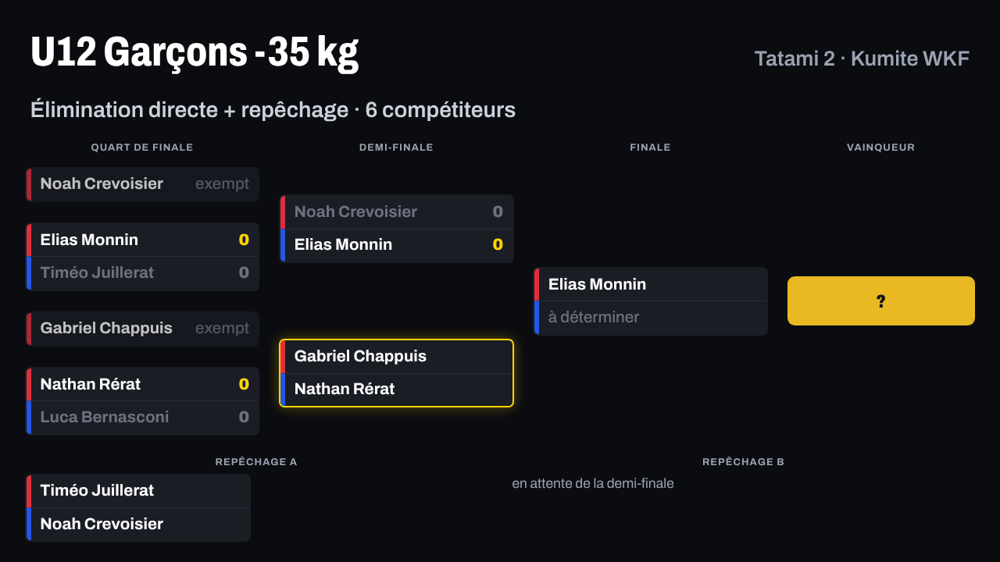

Pour les tableaux de 16 places et plus, la TV n'affiche que les 3 derniers tours et les 3 derniers combats de repêchage.

### 6.9 Si Internet coupe

La pastille en haut passe à **Hors ligne**, avec le nombre de résultats en attente. On continue normalement : chrono, scores, enchaînement des combats du pool chargé. Les résultats partent automatiquement au retour du réseau, et la pastille redevient **En ligne**.

> Ne fermez pas la page et ne vous déconnectez pas tant que des résultats sont « en attente ».

---

## 7. Suivre tous les tatamis (organisation)

La section **Tatamis** montre une copie en direct de chaque écran, le pool et le combat en cours, et le nombre de pools restants. Une alerte apparaît si une table ne donne plus de nouvelles.

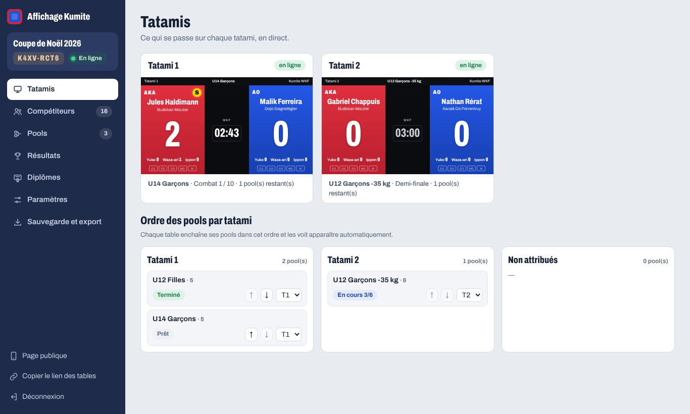

Si un tatami prend du retard, déplacez un de ses pools pas encore commencé vers un autre tatami (liste déroulante T1, T2…) : il apparaît aussitôt sur l'autre table.

---

## 8. La page publique

Lien **Page publique** dans le menu de l'organisation (adresse `public.html#CLÉ`). Pensée pour les téléphones, elle ne montre que le nom et le club des compétiteurs. Pour l'afficher dans la salle, générez un QR code de ce lien avec n'importe quel générateur de QR code.

| En direct | Pools | Classements |
|---|---|---|
| 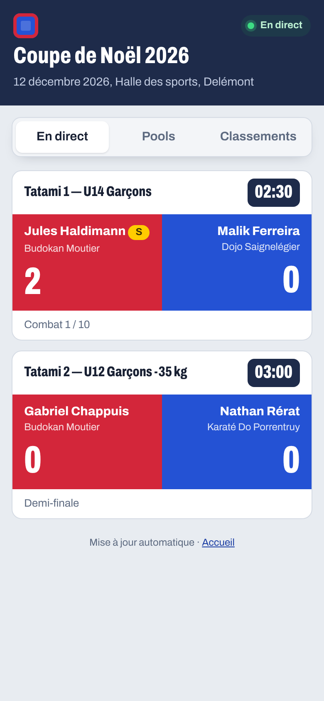 | 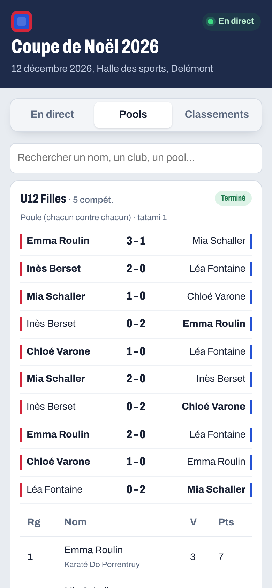 | 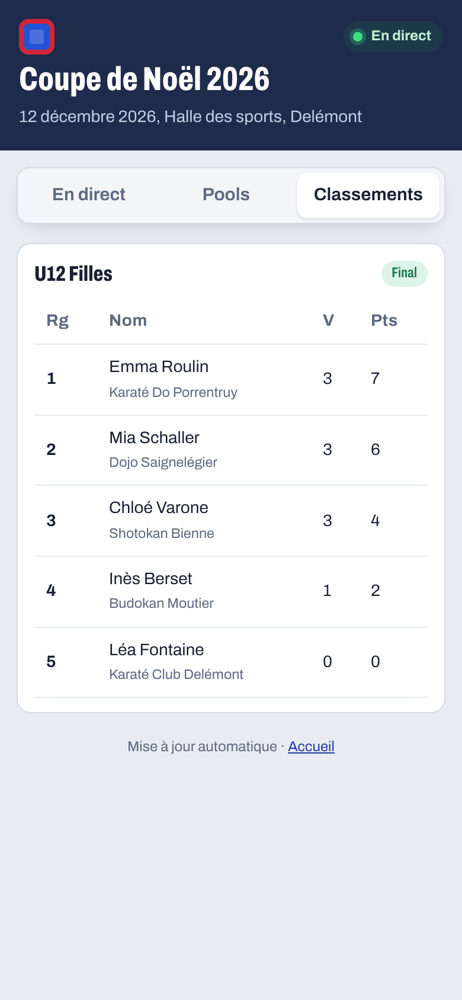 |

---

## 9. Résultats et exports

Section **Résultats** : classement de chaque pool commencé et **historique** de tous les combats (heure, tatami, pool, tour, score). **Exporter les classements (CSV)** produit un fichier pour Excel.

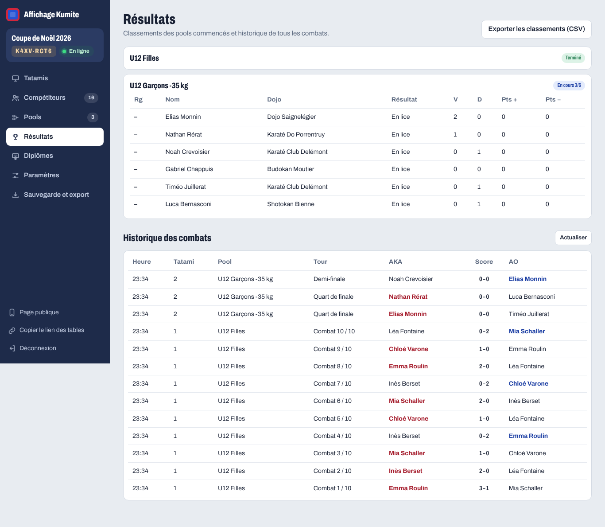

Section **Sauvegarde et export** :

- **Télécharger la sauvegarde** : un fichier `.json` complet (compétiteurs, pools, résultats, sons, modèle de diplôme) ;
- **Importer une sauvegarde (V1 ou V2)** : remplace les compétiteurs et pools du tournoi ;
- **Classements**, **Tous les combats**, **Compétiteurs** : fichiers CSV pour Excel.

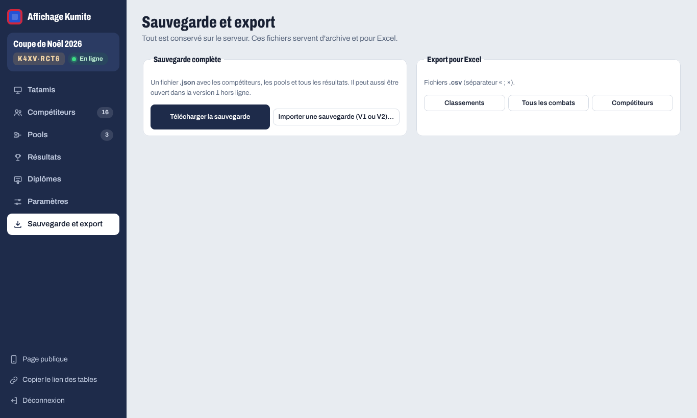

---

## 10. Imprimer les diplômes

Menu **Diplômes**. À gauche les réglages, à droite l'aperçu.

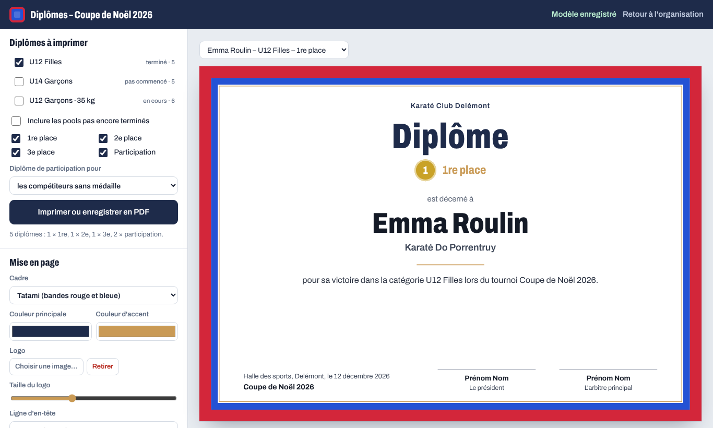

1. **Diplômes à imprimer** : cochez les **pools** (les pools terminés sont cochés d'office) et les types : **1re place**, **2e place**, **3e place** (les bronzes gagnés en repêchage en font partie) et **Participation**. La participation peut aller aux compétiteurs sans médaille ou à tous ; avec « tous », on peut l'imprimer avant les combats en cochant **Inclure les pools pas encore terminés**.
2. **Mise en page** : cadre (Tatami, Classique, Sobre), couleurs, **logo** (image du club), ligne d'en-tête, médaille avec le rang.
3. **Textes** : pour chaque type (onglets 1re, 2e, 3e, Participation), le titre, la mention du rang et la phrase. Champs disponibles : `{nom}` `{club}` `{pool}` `{rang}` `{tournoi}` `{date}` `{lieu}`.
4. **Signatures** : deux signatures (nom et fonction).
5. Le menu au-dessus de l'aperçu affiche n'importe quel diplôme de la liste. Tout est **enregistré automatiquement**.
6. **Imprimer ou enregistrer en PDF** ouvre la fenêtre d'impression du navigateur :
   - **Destination** : votre imprimante, ou **Enregistrer au format PDF** ;
   - **Marges** : *Aucune* ;
   - dans *Plus de paramètres*, cocher **Graphiques d'arrière-plan** (couleurs du cadre et des médailles) ;
   - **Échelle** : 100 %.

Résultat : une page A4 paysage par diplôme.

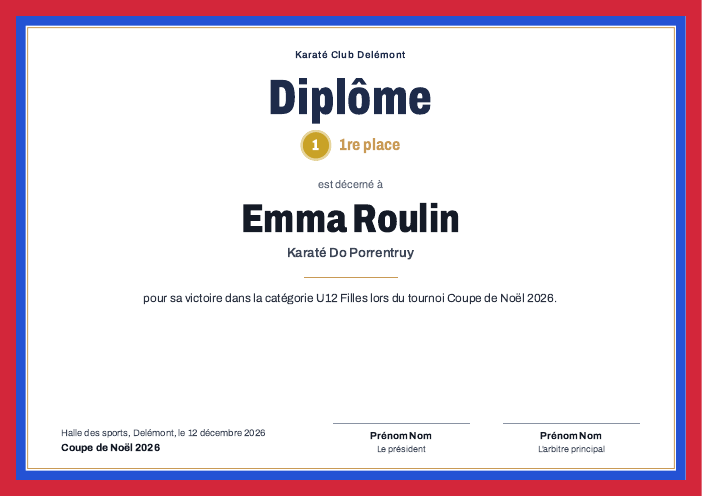

---

## 11. Après le tournoi

- Téléchargez une **sauvegarde** et les **exports CSV** (section 9).
- Le super-admin **archive** le tournoi (`admin.html` → **Archiver**) : il passe en lecture seule, mais l'organisation et la page publique restent consultables. **Réactiver** le rouvre si besoin.

---

## 12. Questions fréquentes

**La fenêtre de l'écran TV ne s'ouvre pas.**
Le navigateur bloque les fenêtres pop-up : autorisez-les pour le site (icône dans la barre d'adresse), puis cliquez à nouveau sur **Ouvrir l'affichage ↗**.

**Il n'y a pas de son.**
Cliquez une fois dans la fenêtre de l'écran TV (les navigateurs exigent un clic avant de jouer du son). Vérifiez le volume dans l'onglet **Réglages** de la table et la sortie son choisie (ordinateur de gestion ou fenêtre d'affichage).

**La voix prononce mal un nom ou ne parle pas.**
La lecture utilise la voix française installée sur le PC. Essayez une autre voix ou une autre vitesse dans **Paramètres → Sons et appel des combattants**. Si le PC n'a aucune voix française, ajoutez-en une dans les paramètres de langue et de voix du système (Windows ou macOS), ou désactivez la lecture des noms.

**Un pool n'apparaît pas sur une table.**
Vérifiez dans l'organisation qu'il est attribué au bon tatami (section **Tatamis** ou **Pools**). Il doit avoir au moins 2 compétiteurs.

**La table demande de se reconnecter (session expirée).**
Les codes ont peut-être été changés par le super-admin, ou la connexion a plus de 3 jours. Reconnectez-vous depuis la page d'accueil : les résultats non envoyés restent sur le PC et partiront ensuite.

**Une erreur de score a été faite.**
Pendant le combat : **↶ Annuler** ou les boutons **−**. Après le combat : **Rejouer** dans la liste des combats de la table, puis terminez à nouveau le combat.

**« Ce tournoi est archivé : il est en lecture seule. »**
Le super-admin doit le **Réactiver** dans `admin.html` pour permettre de nouvelles modifications.
